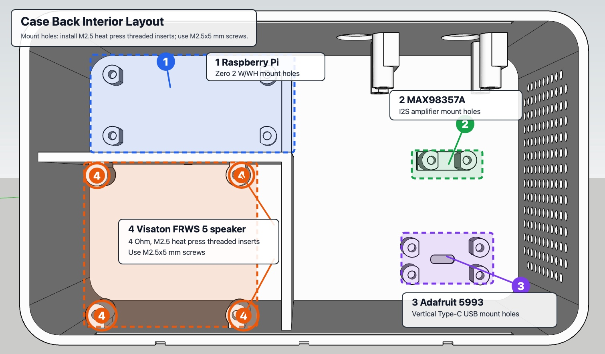
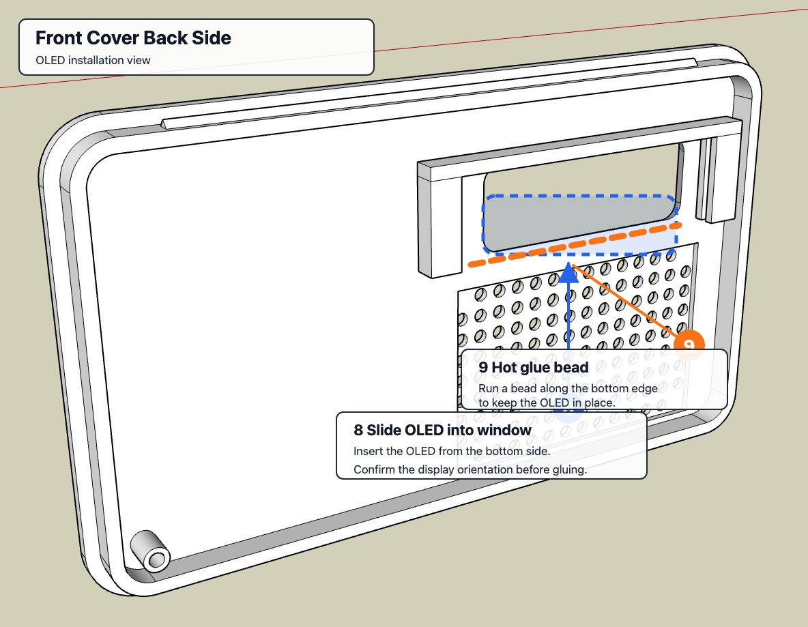
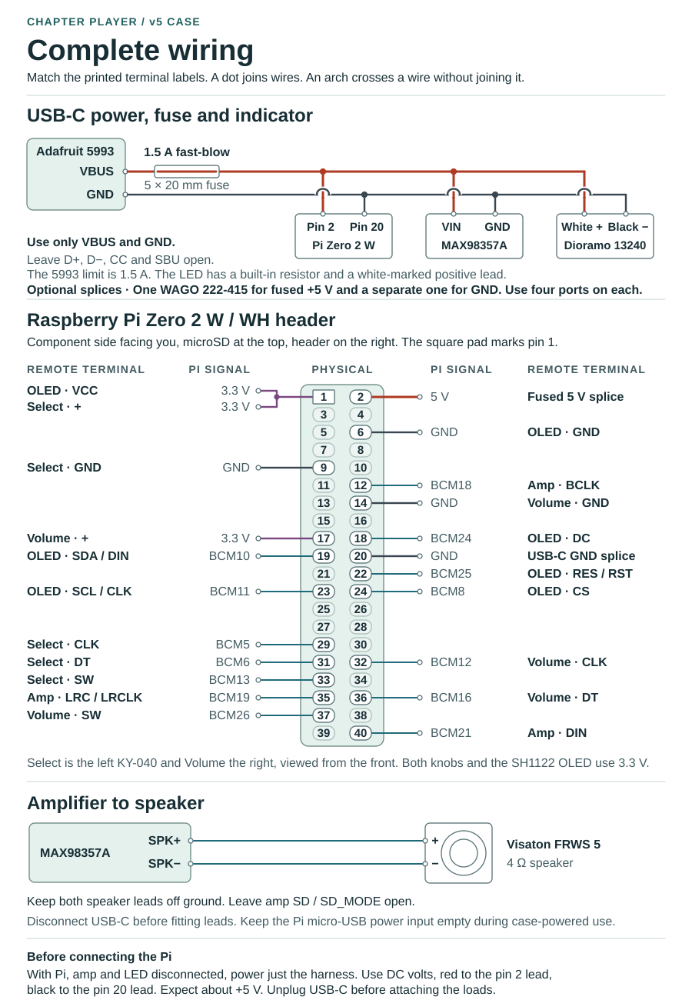

# Build a Chapter Player in the v5 case

Keep the front cover loose until you can select a book and hear it play. If your player is already wired, go straight to the [complete wiring diagram](#check-the-complete-wiring) and [first power check](#test-the-power-harness).

To highlight one wire at a time, open `docs/visual-build-guide.html` in a browser from a copy of this repository. On GitHub, **Code → Download ZIP** includes the interactive guide and its wiring diagram. [Interactive guide source](visual-build-guide.html)

## Prepare the Pi

1. Use a Zero 2 WH or a Zero 2 W with a soldered 40-pin header. Lay out the printed back, front cover and two knobs alongside the boards. The [parts list](hardware-links.md) gives the quantities and exact hardware for one player.
2. Flash Raspberry Pi OS Lite, enable SSH and configure 2.4 GHz Wi-Fi. With the Pi still bare, boot it through its micro-USB `PWR IN` port and run the [versioned installer](raspberry-pi-zero-2w-install.md#run-the-installer).
3. Run `sudo shutdown -h now`. Wait for shutdown, then unplug micro-USB before fitting or wiring the boards.

## Fit the back shell and controls

1. Dry-fit the parts in the numbered positions. Install the 18 M2.5 heat-set inserts in the mounting bosses and let them cool. Solder any leads that will be hard to reach after mounting.
2. Use M2.5 × 5 mm screws to mount the Pi (1), MAX98357A amp (2), Adafruit 5993 (3) and Visaton speaker (4). Align the USB-C socket with the rear opening and face the speaker cone towards the grille.
3. Mount a KY-040 under each labelled opening. Viewed from the front, **Select is on the left and Volume on the right**. Slip the printed knobs onto the shafts and check that both turn and click freely. Fit the four adhesive feet in the bottom recesses. [Encoder mounting view](../hardware/case/case-rotary-encoder-mount-layout.jpg) · [Top view with knob labels](../hardware/case/case-top-select-volume-reference.png)

## Fit the front cover components

Slide the SH1122 OLED up into the window from below. Look through the outside face to check its orientation, then apply a small bead of hot glue along the display’s bottom edge. Insert the 3 mm LED from behind into the hole at the **lower right when viewed from outside**. Secure it with a dab of glue clear of its leads. Rest the cover beside the back shell while you wire.

## Check the complete wiring

[Open the full-size diagram](assets/chapter-v5-wiring.svg) · [Read the pin-by-pin tables](raspberry-pi-zero-2w-install.md#wire-the-hardware) · [Wire the two WAGO connectors](#make-the-two-splices-with-lever-connectors)

With power disconnected, trace the five connections below.

| Start here | Trace to | What to check |
| --- | --- | --- |
| Adafruit 5993 `VBUS` | 1.5 A fast-blow 5 × 20 mm fuse, then Pi **pin 2**, amp `VIN` and LED **+** | All three branches come **after** the fuse. The Dioramo 13240 has a built-in resistor and a white-marked positive lead. |
| 5993 `GND` | Pi **pin 20**, amp `GND` and LED black **−** | Use either labelled pair of `VBUS` and `GND` pads. Leave `D+`, `D−`, `CC` and `SBU` open. |
| Pi **pin 1** | OLED `VCC` **and** Select `+` | Split one 3.3 V lead into two insulated branches. Volume `+` has its own 3.3 V feed from **pin 17**. |
| Each module’s printed signal labels | The physical header positions in the drawing | Hold the Pi component side towards you, microSD at the top, header on the right. Find the square pad for **pin 1**. For example, OLED `DC` uses **physical pin 18** (BCM24). |
| Amp speaker **+** and **−** | Matching **+** and **−** on the 4 Ω speaker | Keep both speaker leads off ground. Leave amp `SD` / `SD_MODE` open. |

The diagram uses physical pins **2** and **20** for the Pi power harness. The install guide also lists equivalent 5 V and ground pins. The 5993 power path is rated for up to **1.5 A**, including when used with a higher-capacity 5 V supply. [Power input notes](raspberry-pi-zero-2w-install.md#usb-c-power-port-and-fuse)

### Make the two splices with lever connectors

The dots along each power rail can be made with a single connector. If you use **two five-port WAGO 222-415 connectors**, every port in one connector is joined internally. With USB-C unplugged, label one connector **Fused +5 V** and the other **GND**. Each row below is one whole connector, with one wire per lever and the fifth port empty.

| Connector | Feed wire | Pi wire | Amp wire | LED wire |
| --- | --- | --- | --- | --- |
| **Fused +5 V** | Output of the 1.5 A fuse | Physical pin 2 | `VIN` | White-marked (+) |
| **GND** | `GND` pad on the 5993 | Physical pin 20 | `GND` | Black (−) |

The 222-415 accepts the Dioramo LED’s fine 28 AWG wire. Its factory-tinned ends are only 8 mm long. Trim those tips and strip 9–10 mm of fresh copper for each lever. Lift the lever, insert the wire fully, close the lever and give the wire a gentle tug. Leave the LED’s inline resistor in place. Dry-fit both connectors with the cover resting on the shell to check clearance before final assembly. [WAGO datasheet](https://assets.cef.co.uk/downloads/pdg/wago_222-415_datasheet/wago_222-415_datasheet.pdf) · [Dioramo lead specification](https://dioramo.com/products/13240)

## Test the power harness

1. **USB-C unplugged, Pi, amp and LED disconnected.** Fit the fuse. Check continuity between the disconnected harness’s positive and ground leads. If it beeps continuously, locate the short before applying power.
2. **Power the harness alone.** Keep the loose ends apart. Set the meter to DC volts. Put the black probe in `COM` on the lead intended for **pin 20**, and the red probe in `V` on the lead for **pin 2**. Expect about **+5 V**. If it reads negative, zero or substantially different, unplug USB-C and recheck the pad labels, fuse and splices.
3. **Unplug USB-C again.** Attach the tested leads to the Pi, amp and LED. Powering through the header bypasses the Pi’s normal input protection. Keep the Pi’s micro-USB `PWR IN` empty when using the rear USB-C socket.

## Boot and close the case

| With the case open | What you should see or hear |
| --- | --- |
| Apply power at the rear USB-C socket | The power LED lights immediately. During boot the OLED shows `chapter`, then setup instructions or the library. |
| [Open the setup page](raspberry-pi-zero-2w-install.md#open-the-setup-page) and sign in with a dedicated Audiobookshelf user | The library appears. Turn Select to browse and press it to choose a book. |
| Play a book, then turn and press Volume | Sound comes from the internal speaker and the level changes. In the default control mode, pressing Volume mutes and unmutes. |

If a check fails, leave the case open. A lit LED confirms power at its branch. For a blank display, check the OLED’s 3.3 V, ground and SPI leads. For a silent speaker, check volume, amp power, the three I²S leads and the speaker pair. Shut down and disconnect power before moving a wire. [Software and hardware troubleshooting](raspberry-pi-zero-2w-install.md#troubleshooting)

When the checks pass, shut down, unplug USB-C and tuck the wires clear of the case rim. Engage one side of the front cover first, then press around the perimeter until the seam sits flush. If a tab resists, lift the cover and check for a trapped wire. Power up and resume the book. [Front cover fitting instructions](../hardware/case/README.md#installing-the-front-cover)
